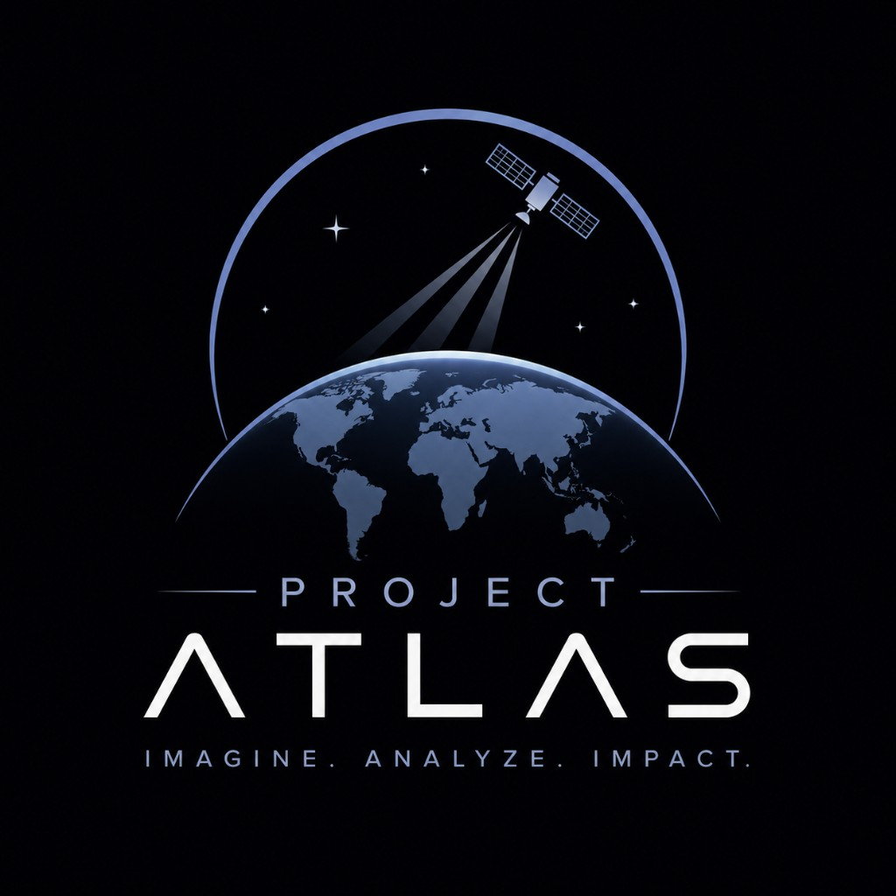

# ATLAS

**Automated Toolkit for Land, Atmosphere, and Sustainability**

<p align="center">
  
</p>

## Overview

ATLAS is a research project in **harness engineering** at the intersection of
aerospace and computer science: automated, cost-efficient satellite imagery
analysis, in part with LLMs. The official focus is satellite data analysis focused on geographical and environmental changes across available data.

## Agent TUI

From this checkout, put `atlas` on your PATH:

```bash
uv tool install --editable --force .
```

`~/.local/bin` must be on PATH. A normal uv install already adds it. The TUI also needs Rust (`cargo`, including `~/.cargo/bin` from rustup) and `OPENROUTER_API_KEY` in `.env`. Machine setup is in the install guides: [macOS](install-instructions/INSTALL-MAC.md), [Linux](install-instructions/INSTALL-LINUX.md), [Windows](install-instructions/INSTALL-WINDOWS.md).

```bash
atlas
```

That opens the agent TUI in the current directory. The first launch builds `tui/target/release/atlas-tui` and can take a few minutes. Later launches reuse that binary and rebuild only after Rust sources change.

`atlas data` stays on the data CLI. `atlas tui --workspace PATH` opens the TUI on another directory.

Enter sends a line. `/` opens commands. `/new` starts a fresh conversation in the same directory. `/skill <name>` applies a skill from `.atlas/skills/<name>/SKILL.md` for the rest of that conversation. `/quit` and `/exit` leave Atlas.

If the workspace root contains `AGENTS.md`, a new session loads that file as project guidance and follows it where it does not conflict with the system prompt. That is the only honored filename. Instruction files in nested directories are ignored, and a closer file does not override the root file. The text can never change tools, the sandbox, or those rules. A missing or unreadable file does not stop the session.

## Layout

Project files go in `.atlas/` in the working directory: `sessions/`, `artifacts/`, `data/`, `skills/`, and `skills-drafts/`. User files go in `~/.atlas/` (`%USERPROFILE%\.atlas` on Windows): `keys/`, `weights/`, `defaults/`, and `skills/`. `ATLAS_HOME` overrides that user directory. The directory list is in [docs/atlas-layout.md](docs/atlas-layout.md).

## Data CLI

`atlas data` lists sources and pulls them. A date window is `START:END`. A box is `west,south,east,north`. A polygon AOI is `--polygon` as `lon,lat` pairs separated by semicolons, or a GeoJSON Polygon. Quote the semicolon list in a shell so `;` is not read as a command separator. Without `--coords`, the search box is that ring's envelope. A ring that winds around a pole is rejected: the boundary does not close inside one 360-degree window, so the interior is not a box or a STAC polygon. Rings longer than 4096 vertices are rejected so the caller can simplify them first. The written manifest stores the polygon and the box sent to catalogs that only accept a bounding box. Scenes from every source are then kept only when they meet the ring: a point must lie inside it, and every other scene is kept when its footprint bounding box meets the ring, because a scene record stores that box rather than the full footprint outline. A box with west greater than east crosses the antimeridian. GIBS and FIRMS request each side of 180° separately. GOES chooses the satellite from each side. Himawari lists its full-disk slot once when either side meets the disk. A rejected dateline request is a source error, not an empty scene.

```bash
atlas data                         # catalog
atlas data sentinel2               # kinds for one satellite

atlas data sentinel2 optical \
  --date 2024-07-01:2024-07-07 \
  --coords -71.12,42.32,-71.02,42.40

atlas data sentinel2 optical \
  --date 2024-07-01:2024-07-07 \
  --polygon '-71.12,42.32;-71.02,42.32;-71.02,42.40;-71.12,42.40'

atlas data fldas landsurface \
  --date 2023-01-01:2024-12-31 \
  --coords -71.2,42.2,-70.9,42.5 \
  --out .atlas/data/fldas
```

Scene pulls download native assets under `.atlas/data` and write `manifest.json`. A date window with no scenes records that failure and moves aside only the previous manifest's files for that source and request (`*.stale`), so an older CSV or chip is not this pull's result. Files from another date or area, and files the manifest did not list, stay put. A search that fails, including an outage, timeout, or rate limit, records the error and does not touch files. A geographic, Web Mercator, or WGS84 UTM Cloud Optimized GeoTIFF is read as the window overlapping `--coords`, using HTTP range requests, instead of downloading the whole granule. A window that misses the raster fails that scene and moves that older chip aside. A server that ignores Range, or a window over the read limit, fails that scene and leaves the older chip in place. An ignored Range does not fall back to a full download. A saved GeoTIFF that viewers show dark or not at all (16-bit, signed, float, or 8-bit with other than three bands, such as NAIP RGBN) gets `<stem>.preview.png` beside it: each band stretched to its 2nd-98th percentile of valid pixels, grayscale for one band, RGB from the first three otherwise, at most 2048 px on the longer side. 8-bit palette and 8-bit RGB files already display and get none. A whole-file download is previewed from a COG overview level, so the preview may be low resolution. The GeoTIFF itself is not changed, the preview is not a scene asset, and a preview failure is reported as a warning without failing the download. The manifest lists previews under `previews`. `--search-only` skips the download, records an empty window, and does not touch files. `--limit` caps scenes per source (default 100). Each source records `next_cursor` when its STAC page has a next link. `--resume` reads those cursors and requests the following page instead of page one. A source with no cursor is left as recorded. A next link with a signed query is not stored. When that link is the only continuation, later pages stay unfetched: the source records `next_cursor_unavailable`, the pull prints a warning, and the exit status stays 0. Resume repeats that warning. A resume rejected with a 4xx status clears the stored cursor so a later pull without `--resume` starts at page one.

One `--out` directory can hold several sources and several windows. `manifest.json` has one row per source under `sources`, and each row carries its own `request` (dates, box, and polygon) next to its `saved`, `skipped`, and `failed` files and its `next_cursor`. A pull rewrites only the rows for the sources it searched; rows for other sources, including ones pulled for a different window, are kept. Pulling the same source for a new window replaces that source's row; its old files stay on disk. The top-level `request` describes the most recent pull. `--resume` reads only the rows for the sources it names and is refused when one of them was written for a different search. The empty-window cleanup moves aside only files listed by that source's row for the same window. A row written before rows carried a `request` is treated as belonging to the top-level request and is stamped with it when kept.

Downloads are written to a hidden `.<name>.part` file and renamed when complete, so an interrupted pull never leaves a truncated file that a later pull skips as present. A GOES file saved under the old `<id>.nc_data.nc` name is renamed to `<id>_data.nc` and not downloaded again. Failure text in the CLI summary and in `manifest.json` has URL query strings, signed-URL parameters (`sig`, `se`, `X-Amz-*`, `token`, ...), and the FIRMS map key removed. Planetary Computer href signing retries 429 and 5xx up to 8 times, honoring `Retry-After` up to 16 s per wait.

`fldas landsurface` writes `.atlas/data/fldas/fldas.csv`: one row per 0.1° cell per month (January 1982 through the latest published month). Set `EARTHDATA_TOKEN` in `.env`, or save it with `/key earthdata user` or `/key earthdata session`, and approve **Hyrax in the cloud** and **NASA GESDISC DATA ARCHIVE**. See `.env.example`.

## Contribute!

### Set up

For installation, see the following guide to set up your machine for development:

- [macOS](install-instructions/INSTALL-MAC.md)
- [Windows](install-instructions/INSTALL-WINDOWS.md)
- [Linux](install-instructions/INSTALL-LINUX.md)

### Docstrings

New and changed public Python APIs use [Google docstring
style](https://google.github.io/styleguide/pyguide.html#38-comments-and-docstrings)
(`Args:`, `Returns:`, `Raises:`). Docstring formatting is primarily for
functions, methods, and classes, as seen in 3.8.3 and 3.8.4. Ruff is set to
`convention = "google"`.

### Checks
Most checks run automatically on every commit via pre-commit hooks (once
installed). You can also run the full verification suite manually:

```bash
uv run pytest                       # run tests (no live APIs)
uv run ruff check .                 # lint
uv run ruff format .                # format
uv run mypy src                     # type-check
uv run pre-commit run --all-files   # run all hooks on the whole repo
```

### Versioning

Every merge to `main` must bump `[project].version` in `pyproject.toml`. Do not
land on `main` at the same version as the previous release. From `0.1.0`:

```bash
uv version --bump patch   # 0.1.0 → 0.1.1   bug fix, docs, internal change
uv version --bump minor   # 0.1.0 → 0.2.0   new feature, backward compatible
uv version --bump major   # 0.1.0 → 1.0.0   breaking API or data-contract change
```
