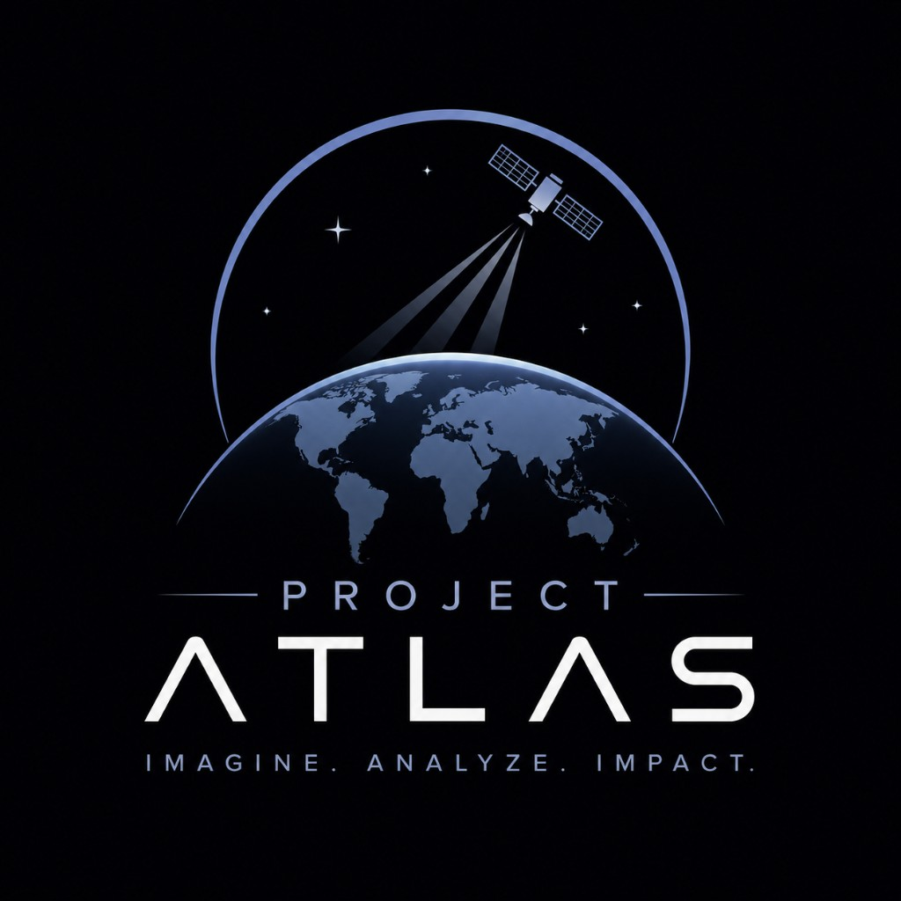

# ATLAS

**Automated Toolkit for Land, Atmosphere, and Sustainability**

<p align="center">
  
</p>

## Overview

ATLAS is a research project in **harness engineering** at the intersection of
aerospace and computer science: automated, cost-efficient satellite imagery
analysis, in part with LLMs. The focus is satellite data analysis of
geographical and environmental change across available data.

## Agent TUI

From this checkout, put `atlas` on your PATH:

```bash
uv tool install --editable --force .
```

`~/.local/bin` must be on PATH; a normal uv install adds it. The TUI also needs
Rust (`cargo`, including `~/.cargo/bin` from rustup) and `OPENROUTER_API_KEY` in
`.env`. Machine setup is in the install guides:
[macOS](install-instructions/INSTALL-MAC.md),
[Linux](install-instructions/INSTALL-LINUX.md),
[Windows](install-instructions/INSTALL-WINDOWS.md).

```bash
atlas                              # open the TUI in the current directory
atlas tui --workspace PATH         # open the TUI on another directory
atlas data                         # data CLI (see below)
```

The first launch builds `tui/target/release/atlas-tui` and can take a few
minutes; later launches reuse it and rebuild only after Rust sources change.

Enter sends a line. `/` opens commands. `/new` starts a fresh conversation.
`/skill <name>` applies a skill from `.atlas/skills/<name>/SKILL.md` for the
rest of the conversation. `/quit` and `/exit` leave Atlas.

A new session loads a workspace-root `AGENTS.md`, if present, as project
guidance that is followed where it does not conflict with the system prompt.
It is the only honored filename; nested instruction files are ignored, and no
file can change tools or the system rules.

## Layout

Project files live in `.atlas/` in the working directory (`sessions/`,
`artifacts/`, `data/`, `skills/`, `skills-drafts/`). User files live in
`~/.atlas/` (`%USERPROFILE%\.atlas` on Windows): `keys/`, `weights/`,
`defaults/`, `skills/`. `ATLAS_HOME` overrides the user directory. See
[docs/atlas-layout.md](docs/atlas-layout.md).

## Data CLI

`atlas data` lists sources and pulls them. A date window is `START:END`. A box
is `west,south,east,north`. A polygon AOI is `--polygon` with `lon,lat` pairs
separated by semicolons, or a GeoJSON Polygon (quote the semicolon list in a
shell). Without `--coords`, the search box is the polygon's envelope, and scenes
are kept only when they meet the ring.

```bash
atlas data                         # catalog
atlas data sentinel2               # kinds for one satellite

atlas data sentinel2 optical \
  --date 2024-07-01:2024-07-07 \
  --coords -71.12,42.32,-71.02,42.40

atlas data sentinel2 optical \
  --date 2024-07-01:2024-07-07 \
  --polygon '-71.12,42.32;-71.02,42.32;-71.02,42.40;-71.12,42.40'

atlas data fldas landsurface \
  --date 2023-01-01:2024-12-31 \
  --coords -71.2,42.2,-70.9,42.5 \
  --out .atlas/data/fldas
```

Scene pulls download native assets under `.atlas/data` and write
`manifest.json`. A box with west greater than east crosses the antimeridian and
is sent to STAC as two rings.

- **Empty windows.** A window with no scenes records the failure and moves
  aside only that source's previous files for the same request (`*.stale`). A
  failed search records the error and touches no files.
- **Windowed reads.** Geographic, Web Mercator, and WGS84 UTM Cloud Optimized
  GeoTIFFs are read as the window overlapping `--coords` via HTTP range
  requests, instead of downloading the whole granule. A windowed chip is reused
  when a marker records the same AOI. An ignored Range does not fall back to a
  full download; that scene fails and its older chip is left in place.
- **Previews.** A saved GeoTIFF that viewers show dark (16-bit, signed, float,
  or non-3-band 8-bit) gets `<stem>.preview.png` beside it, stretched per band
  to the 2nd-98th percentile. The GeoTIFF is unchanged; previews are listed
  under `previews` in the manifest.
- **Options.** `--search-only` skips the download. `--limit` caps scenes per
  source (default 100). `--resume` reads stored `next_cursor` values and
  requests the following STAC page.
- **Exit status.** A pull that attempts downloads and saves none exits 1;
  search-only pulls and empty windows exit 0.

One `--out` directory can hold several sources and windows. Pulls into the same
directory serialize the manifest read-merge-write, so concurrent rows survive.
Each row under `sources` carries its own `request` next to its `saved`,
`skipped`, and `failed` files. Pulling a source for a new window replaces that
row; its old files stay on disk.

Downloads are written to a hidden `.<name>.part` file and renamed when complete,
so an interrupted pull never leaves a truncated file. Failure text in the CLI
summary and `manifest.json` has URL query strings, signed-URL parameters, and
the FIRMS map key removed.

`fldas landsurface` writes `.atlas/data/fldas/fldas.csv`: one row per 0.1° cell
per month (January 1982 onward). Set `EARTHDATA_TOKEN` in `.env`, or save it with
`/key earthdata user` or `/key earthdata session`, and approve **Hyrax in the
cloud** and **NASA GESDISC DATA ARCHIVE**. See `.env.example`.

## Contribute!

### Set up

Installation guides for development:
[macOS](install-instructions/INSTALL-MAC.md),
[Windows](install-instructions/INSTALL-WINDOWS.md),
[Linux](install-instructions/INSTALL-LINUX.md).

### Docstrings

New and changed public Python APIs use
[Google docstring style](https://google.github.io/styleguide/pyguide.html#38-comments-and-docstrings)
(`Args:`, `Returns:`, `Raises:`). Ruff is set to `convention = "google"`.

### Checks

Most checks run on every commit via pre-commit hooks (once installed). Run the
full suite manually:

```bash
uv run pytest                       # tests (no live APIs)
uv run ruff check .                 # lint
uv run ruff format .                # format
uv run mypy src                     # type-check
uv run pre-commit run --all-files   # all hooks on the whole repo
```

### Versioning

Every merge to `main` must bump `[project].version` in `pyproject.toml`. Do not
land on `main` at the same version as the previous release:

```bash
uv version --bump patch   # 0.1.0 → 0.1.1   bug fix, docs, internal change
uv version --bump minor   # 0.1.0 → 0.2.0   new feature, backward compatible
uv version --bump major   # 0.1.0 → 1.0.0   breaking API or data-contract change
```
